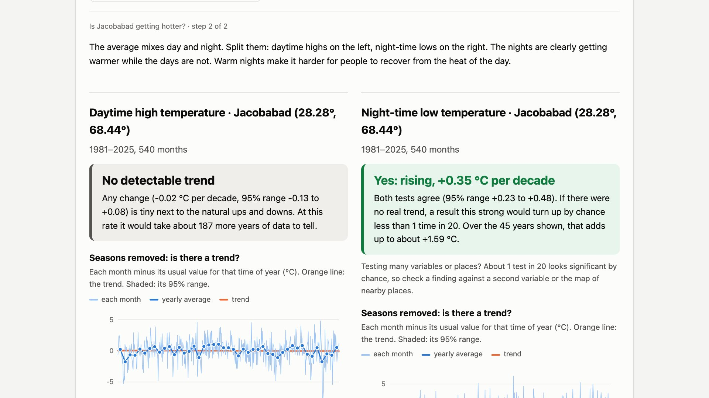
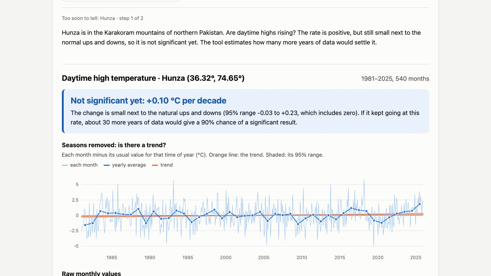
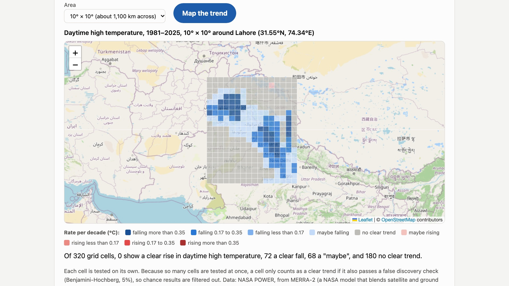

# Earth Trend Detective

**Is it really changing, or is it too soon to say?**

Pick a place and a question. Earth Trend Detective downloads 45 years of NASA data for that place,
removes the seasons, runs two statistical tests, and answers in plain words: **yes**, **maybe**,
**not significant yet** (with how many more years of data it would take), or **no detectable trend**.
A map then shows *where* around that place the same variable is rising, falling or not changing.

- **Live site:** https://earth-trend-detective.vercel.app (free, no login, works on phones)
- **Team:** Ludilume Studios: Talha Abid (Pakistan) and Kainat Ijaz (USA)
- **Challenge:** NASA Space Apps 2026, "Be An Earth System Trend Detective!"
- **Made during the event**, 14–15 November 2026. MIT licence.



## Why we built it

People hear "it's getting hotter" all the time, but one hot summer is not a trend, and a chart
with a straight line drawn through it is not proof. NASA's data can answer the question properly,
but the tools are made for scientists. Students, teachers and curious people need something that
does the statistics honestly and explains the answer, including when the honest answer is
"we can't tell yet".

## What it does (the challenge's four objectives)

| Objective | How the tool meets it |
|---|---|
| Identify variables of interest | 14 NASA variables in four themes (heat, rain and water, air and sky, snow and cold), each with a one-line plain definition and why it matters. A "what kind of place is this?" helper suggests where to start for cities, deserts, mountains, farmland, rainforests and coasts. |
| Get the data for a region | Click any point on Earth. Choose one grid cell (about 50 km) or a 2° × 2° area (cells averaged by size). For the map, every cell in a 6° or 10° box. |
| Make and show a long time series | Monthly data from 1981 to 2025: the raw series, the usual seasonal cycle, and the series with seasons removed, with yearly averages. |
| Test the trend's rate and significance | Seasonal Mann-Kendall test with the Sen slope and a 95% range, and a straight-line test that allows for month-to-month memory. "Yes" only when both agree. If not significant, an estimate of how many more years would settle it. |

It also includes **four step-by-step examples** (the challenge asks for demonstration examples)
that load instantly, even if NASA's servers are busy.

## What the examples found

All numbers come from the site and from `engine/scripts/build_examples.py`, which stops if a
story's text does not match the data.

| Place | Question | Answer |
|---|---|---|
| Jacobabad, Pakistan | Is it getting hotter? | Average temperature: no detectable trend. Night-time lows: **+0.35 °C per decade** (95% range +0.23 to +0.48). Daytime highs: no trend. |
| Lahore vs Phoenix (USA) | Is the air getting more humid? | **+2.9% per decade in Lahore, −1.7% in Phoenix.** Daytime highs fall in Lahore (−0.27 °C) and rise in Phoenix (+0.36 °C). Opposite directions. |
| Hunza, Pakistan | Are daytime highs rising? | **Not significant yet** (+0.10 °C per decade, range −0.03 to +0.23). About 30 more years of data would settle it. The average temperature is clearly rising (+0.21 °C). |
| Central Lahore and the Thar desert | Is the land getting greener? (MODIS satellite) | Yes in both, since 2000. A separate NASA dataset (soil wetness) agrees for Thar. |

| | |
|---|---|
|  |  |

## Why you can trust the numbers

- **Two tests must agree** before the tool says "yes". Monthly data has memory (one unusual month
  makes the next likely to be unusual too), which makes simple tests over-confident; the second
  test corrects for that.
- **Checked against independent code:** our Mann-Kendall test matches the `pymannkendall` library
  and our Sen slope and its 95% range match SciPy's `theilslopes` exactly. The browser version
  and the Python version give the same numbers (automatic tests on every change).
- **Many tests at once are handled honestly:** the map tests hundreds of grid cells, so it uses a
  false discovery check (Benjamini-Hochberg) to filter out chance results.
- **Traps avoided:** POWER's extra "annual" month and missing-value codes are removed; missing
  months are never filled in; the sunlight and cloud variables start in 2001 so a change of
  satellite product cannot look like a trend.
- **Limits stated:** POWER is a model-based product at about 50 km, not a weather station; a
  straight-line trend is a summary; finding a change is not explaining its cause.

Full details: [docs/METHODS.md](docs/METHODS.md).

## NASA data

- **NASA POWER** monthly API (v2.10.0), which serves NASA's **MERRA-2** reanalysis (named in the
  challenge) and **CERES** satellite products. Used live for any place on Earth.
- **MODIS** on NASA's Terra satellite, vegetation index MOD13Q1 v6.1 (250 m), from the ORNL DAAC
  MODIS Web Service. Used in the examples (too slow to download live).

The data was obtained from National Aeronautics and Space Administration (NASA) Langley Research
Center's Prediction Of Worldwide Energy Resources (POWER) project funded through the NASA Earth
Science Division. All sources and licences: [docs/DATA_SOURCES.md](docs/DATA_SOURCES.md).

## Use of SI

As the NASA Space Apps rules require: Claude Code (Anthropic) wrote nearly all of the code and
drafted the text, the written concept and a pre-event plan, under the team's direction. The demo
video's English voice-over was generated with Kokoro-82M (open-weight text-to-speech), and the
video was put together by scripts Claude wrote. No SI runs in the website, no data was generated
by SI, and no SI-generated images or music are used.

Prior work: none reused ([docs/REUSED.md](docs/REUSED.md)).

## How it is built

- `web/`: the website. Plain HTML, CSS and JavaScript, no build step. Our own SVG charts; Leaflet
  for maps. Hosted on Vercel's free plan.
- `web/js/stats.js`: the statistics, run in the visitor's browser.
- `engine/`: the same statistics in Python, the tests, and scripts that build the examples.

Run it yourself:

```bash
python3 -m http.server 8000 --directory web
```

Run the tests (Python 3.12 and Node 24):

```bash
pip install -r engine/requirements.txt && cd engine && python -m pytest
```

Rebuild the examples:

```bash
cd engine && python -m scripts.build_examples
```

## What's next

A classroom worksheet mode, more satellite variables (rainfall from GPM, air quality from OMI and
the ESA Sentinel-5P mission), and Urdu as a second language for students in Pakistan.
